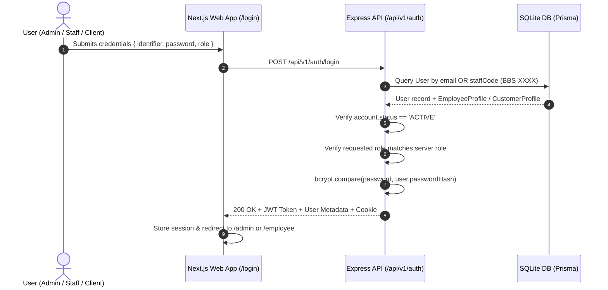

# Beyond Beauty Saloon — Authentication & Role-Based Access Control (RBAC) Specification

**Document Version:** 1.0  
**Status:** Approved & Implemented  
**Date:** 28 October 2026  

---

## 1. Authentication Architecture & Flow

Authentication is enforced strictly server-side using signed JSON Web Tokens (JWT) and bcrypt password hashing.

---

## 2. Server-Side RBAC Permission Matrix

| Endpoint | Method | Permitted Roles | Description / Business Rule |
|---|---|:---:|---|
| `/api/v1/auth/login` | `POST` | Public | Authenticates credentials; matches role; checks active status |
| `/api/v1/auth/register` | `POST` | Public | Registers public client accounts only (`CUSTOMER`) |
| `/api/v1/auth/me` | `GET` | All Authenticated | Returns caller profile details |
| `/api/v1/admin/staff` | `GET` | `OWNER_ADMIN` | Lists full staff roster with salary and status |
| `/api/v1/admin/staff` | `POST` | `OWNER_ADMIN` | Creates staff profile & issues `BBS-XXXX` + temp password |
| `/api/v1/admin/staff/:id` | `PATCH` | `OWNER_ADMIN` | Updates staff profile, toggles active/disabled, resets password |
| `/api/v1/admin/staff/:id` | `DELETE` | `OWNER_ADMIN` | Safe-disables staff account (preserves historical bookings) |
| `/api/v1/admin/appointments`| `GET` | `OWNER_ADMIN` | View all appointments salon-wide |
| `/api/v1/admin/stats` | `GET` | `OWNER_ADMIN` | Computes salon revenue, appointment counts, active staff |
| `/api/v1/employee/appointments` | `GET` | `EMPLOYEE` | View only appointments allocated to caller staff profile |
| `/api/v1/employee/service-entry`| `POST`| `EMPLOYEE` | Logs service status transitions (`IN_SERVICE`, `COMPLETED`) |
| `/api/v1/employee/attendance` | `POST` | `EMPLOYEE` | Clock in / out daily attendance timestamp |
| `/api/v1/employee/notifications`| `GET` | `EMPLOYEE` | View assigned workstation notifications |
| `/api/v1/appointments` | `POST` | Public / Auth | Atomic reservation with concurrency conflict prevention (409) |
| `/api/v1/appointments/:id/status`| `PATCH`| Owner, Assigned Staff, Customer | Enforces ownership and allowed status transitions |

---

## 3. Account Status & Lifecycle

Every user account has an explicit `status` field:
- `ACTIVE`: Normal operation.
- `DISABLED`: Deactivated by administrator. Immediately rejected on login with `403 Forbidden` (`"This account has been deactivated. Please contact salon management."`).
- `SUSPENDED`: Temporarily restricted.

Historical data integrity is preserved: deactivating a staff member sets `status = 'DISABLED'` and `isPublicBookable = false`. It **never hard-deletes** historical appointments, customer records, or financial billing records.

---

## 4. Staff Code Generation (`BBS-XXXX`)

Staff codes are automatically allocated upon profile creation:
1. Format: `BBS-XXXX`, where `XXXX` is a zero-padded sequential 4-digit number (e.g. `BBS-0001`, `BBS-0002`).
2. Collision safeguard: If a code collision is detected, a fallback random unique suffix is generated (`BBS-XXXX`).
3. Staff codes are indexed and can be used interchangeably with registered emails in the login portal.

---

## 5. Password & Credential Security Policy

1. **Storage:** Hashed with `bcryptjs` using a minimum salt work factor of 10.
2. **Temporary Credential Issuance:**
   - When the admin creates a new staff account, a secure random temporary password (e.g. `Pass@306933`) is generated.
   - The password is shown **once** in the administrative interface modal.
   - The employee is prompted to update their password via `POST /api/v1/auth/change-password` upon initial login.
3. **No Hardcoded Production Secrets:** JWT secret is loaded from environment variables (`JWT_SECRET`) with development fallback.

