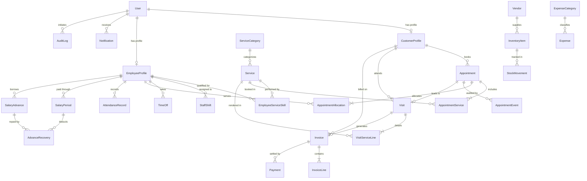

# Data Model & Schema Specification: Beyond Beauty Saloon

**Project Slug:** `beyond-beauty-saloon`  
**Date:** 27 October 2026  
**Version:** 1.0.0  
**Baseline Document:** [PRD.md](../PRD.md)

---

## 1. Entity-Relationship Diagram (ERD)

---

## 2. Relational Entity Definitions

### 2.1 Identity, Users & RBAC

#### `users`
Central authentication identity table.
- `id` (UUID, Primary Key)
- `email` (VARCHAR(255), Unique, Indexed)
- `phone` (VARCHAR(30), Nullable, Indexed)
- `password_hash` (VARCHAR(255), Not Null) - Stored via Argon2id or bcrypt
- `role` (ENUM: `'CUSTOMER'`, `'EMPLOYEE'`, `'OWNER_ADMIN'`)
- `status` (ENUM: `'ACTIVE'`, `'SUSPENDED'`, `'INACTIVE'`)
- `first_name` (VARCHAR(100), Not Null)
- `last_name` (VARCHAR(100), Not Null)
- `email_verified_at` (TIMESTAMPTZ, Nullable)
- `phone_verified_at` (TIMESTAMPTZ, Nullable)
- `created_at` (TIMESTAMPTZ, Default NOW())
- `updated_at` (TIMESTAMPTZ, Auto-update)

#### `customer_profiles`
Customer-specific preferences, notes, and CRM information.
- `id` (UUID, Primary Key)
- `user_id` (UUID, Unique, Foreign Key -> `users.id` ON DELETE CASCADE)
- `gender` (VARCHAR(50), Nullable)
- `date_of_birth` (DATE, Nullable)
- `allergies_or_sensitivities` (TEXT, Nullable)
- `preferred_stylist_notes` (TEXT, Nullable)
- `marketing_consent` (BOOLEAN, Default FALSE)
- `total_visits_count` (INTEGER, Default 0)
- `created_at` (TIMESTAMPTZ)
- `updated_at` (TIMESTAMPTZ)

#### `employee_profiles`
Salon staff details, roster settings, and employment contract parameters.
- `id` (UUID, Primary Key)
- `user_id` (UUID, Unique, Foreign Key -> `users.id` ON DELETE CASCADE)
- `staff_code` (VARCHAR(50), Unique) - e.g. "EMP-001"
- `display_name` (VARCHAR(100), Not Null)
- `job_title` (VARCHAR(100), Not Null) - e.g. "Senior Hair Stylist"
- `is_public_bookable` (BOOLEAN, Default TRUE) - Controls visibility in booking dropdown
- `employment_status` (ENUM: `'FULL_TIME'`, `'PART_TIME'`, `'PROBATION'`, `'TERMINATED'`)
- `base_salary_paise` (INTEGER, Default 0) - Monthly salary in paise (₹1 = 100 paise)
- `commission_rate_bps` (INTEGER, Default 0) - Basis points (e.g. 500 = 5%)
- `date_of_joining` (DATE, Not Null)
- `color_tag` (VARCHAR(20), Default '#B78693') - For calendar visualization
- `created_at` (TIMESTAMPTZ)
- `updated_at` (TIMESTAMPTZ)

#### `employee_service_skills`
Cross-table specifying which employees are qualified to perform specific services.
- `id` (UUID, Primary Key)
- `employee_id` (UUID, Foreign Key -> `employee_profiles.id` ON DELETE CASCADE)
- `service_id` (UUID, Foreign Key -> `services.id` ON DELETE CASCADE)
- `proficiency_level` (VARCHAR(50), Default 'STANDARD')
- Unique constraint: `(employee_id, service_id)`

---

### 2.2 Catalog & Taxonomy

#### `service_categories`
Taxonomy groupings (e.g., Hair Styling, Hair Care, Skin Care, Makeup, Threading, Packages).
- `id` (UUID, Primary Key)
- `slug` (VARCHAR(100), Unique, Indexed)
- `name` (VARCHAR(100), Not Null)
- `description` (TEXT, Nullable)
- `display_order` (INTEGER, Default 0)
- `is_active` (BOOLEAN, Default TRUE)
- `created_at` (TIMESTAMPTZ)
- `updated_at` (TIMESTAMPTZ)

#### `services`
Catalog of offerings available in the salon.
- `id` (UUID, Primary Key)
- `category_id` (UUID, Foreign Key -> `service_categories.id`)
- `slug` (VARCHAR(120), Unique, Indexed)
- `name` (VARCHAR(150), Not Null)
- `short_description` (VARCHAR(300), Nullable)
- `full_description` (TEXT, Nullable)
- `duration_minutes` (INTEGER, Not Null) - Nominal service execution time
- `buffer_after_minutes` (INTEGER, Default 5) - Cleaning/prep buffer before next booking
- `price_paise` (INTEGER, Nullable) - Stored in paise; NULL indicates "Ask for price"
- `is_price_variable` (BOOLEAN, Default FALSE) - True for consultation-dependent treatments
- `requires_consultation` (BOOLEAN, Default FALSE)
- `is_active` (BOOLEAN, Default TRUE)
- `is_featured` (BOOLEAN, Default FALSE)
- `preparation_notes` (TEXT, Nullable)
- `aftercare_notes` (TEXT, Nullable)
- `created_at` (TIMESTAMPTZ)
- `updated_at` (TIMESTAMPTZ)

---

### 2.3 Scheduling, Shifts & Working Hours

#### `business_operating_hours`
Configured weekly opening hours for the salon.
- `id` (UUID, Primary Key)
- `day_of_week` (INTEGER, Not Null) - 0 = Sunday, 1 = Monday, ..., 6 = Saturday
- `is_closed` (BOOLEAN, Default FALSE)
- `open_time` (TIME, Not Null) - e.g. "10:00:00"
- `close_time` (TIME, Not Null) - e.g. "20:00:00"
- `created_at` (TIMESTAMPTZ)
- `updated_at` (TIMESTAMPTZ)

#### `business_closures`
Exceptional holiday closures or special operating day schedules.
- `id` (UUID, Primary Key)
- `closure_date` (DATE, Not Null)
- `reason` (VARCHAR(200), Not Null)
- `is_full_day` (BOOLEAN, Default TRUE)
- `open_time` (TIME, Nullable)
- `close_time` (TIME, Nullable)

#### `staff_shifts`
Scheduled working shifts for employees.
- `id` (UUID, Primary Key)
- `employee_id` (UUID, Foreign Key -> `employee_profiles.id`)
- `day_of_week` (INTEGER, Not Null)
- `shift_start` (TIME, Not Null)
- `shift_end` (TIME, Not Null)
- `break_start` (TIME, Nullable)
- `break_end` (TIME, Nullable)
- `is_recurring` (BOOLEAN, Default TRUE)

#### `time_off`
Approved employee leaves, sick days, and blocked personal times.
- `id` (UUID, Primary Key)
- `employee_id` (UUID, Foreign Key -> `employee_profiles.id`)
- `start_time` (TIMESTAMPTZ, Not Null)
- `end_time` (TIMESTAMPTZ, Not Null)
- `type` (ENUM: `'CASUAL_LEAVE'`, `'SICK_LEAVE'`, `'EMERGENCY'`, `'ADMIN_BLOCK'`)
- `status` (ENUM: `'PENDING'`, `'APPROVED'`, `'REJECTED'`)
- `notes` (TEXT, Nullable)

---

### 2.4 Appointments & Booking Invariants

#### `appointments`
Core booking entity representing a scheduled visit.
- `id` (UUID, Primary Key)
- `reference_code` (VARCHAR(20), Unique, Indexed) - Human readable, e.g. "BBS-20261027-4821"
- `customer_id` (UUID, Foreign Key -> `customer_profiles.id`)
- `status` (ENUM: `'REQUESTED'`, `'CONFIRMED'`, `'CHECKED_IN'`, `'IN_SERVICE'`, `'COMPLETED'`, `'CANCELLED_BY_CUSTOMER'`, `'CANCELLED_BY_STAFF'`, `'NO_SHOW'`, `'REJECTED'`)
- `start_time` (TIMESTAMPTZ, Not Null, Indexed)
- `end_time` (TIMESTAMPTZ, Not Null, Indexed)
- `total_duration_minutes` (INTEGER, Not Null)
- `estimated_total_paise` (INTEGER, Default 0)
- `customer_notes` (TEXT, Nullable)
- `internal_notes` (TEXT, Nullable)
- `idempotency_key` (VARCHAR(100), Unique, Nullable)
- `cancellation_reason` (VARCHAR(255), Nullable)
- `cancelled_at` (TIMESTAMPTZ, Nullable)
- `created_at` (TIMESTAMPTZ, Default NOW())
- `updated_at` (TIMESTAMPTZ)

#### `appointment_services`
Items scheduled within a single appointment.
- `id` (UUID, Primary Key)
- `appointment_id` (UUID, Foreign Key -> `appointments.id` ON DELETE CASCADE)
- `service_id` (UUID, Foreign Key -> `services.id`)
- `sequence_order` (INTEGER, Default 1)
- `duration_minutes` (INTEGER, Not Null)
- `price_at_booking_paise` (INTEGER, Nullable)

#### `appointment_allocations`
Resource & employee reservation periods enforcing exclusion.
- `id` (UUID, Primary Key)
- `appointment_id` (UUID, Foreign Key -> `appointments.id` ON DELETE CASCADE)
- `employee_id` (UUID, Foreign Key -> `employee_profiles.id`)
- `start_time` (TIMESTAMPTZ, Not Null)
- `end_time` (TIMESTAMPTZ, Not Null) - Includes service duration + buffer
- Unique exclusion constraint: `(employee_id, tstzrange(start_time, end_time))` for active statuses.

#### `appointment_events`
Append-only audit trail of state transitions.
- `id` (UUID, Primary Key)
- `appointment_id` (UUID, Foreign Key -> `appointments.id` ON DELETE CASCADE)
- `previous_status` (VARCHAR(50), Nullable)
- `new_status` (VARCHAR(50), Not Null)
- `actor_user_id` (UUID, Foreign Key -> `users.id`)
- `reason` (VARCHAR(255), Nullable)
- `metadata` (JSONB, Nullable)
- `created_at` (TIMESTAMPTZ, Default NOW())

---

### 2.5 Visits, Billing & Manual Payments

#### `visits`
Operational record of customer in salon (linked to appointment or walk-in).
- `id` (UUID, Primary Key)
- `appointment_id` (UUID, Unique, Nullable, Foreign Key -> `appointments.id`)
- `customer_id` (UUID, Foreign Key -> `customer_profiles.id`)
- `primary_employee_id` (UUID, Foreign Key -> `employee_profiles.id`)
- `is_walk_in` (BOOLEAN, Default FALSE)
- `check_in_time` (TIMESTAMPTZ, Not Null)
- `completion_time` (TIMESTAMPTZ, Nullable)
- `status` (ENUM: `'IN_PROGRESS'`, `'COMPLETED'`, `'CANCELLED'`)
- `service_notes` (TEXT, Nullable)
- `created_at` (TIMESTAMPTZ)
- `updated_at` (TIMESTAMPTZ)

#### `visit_service_lines`
Specific services rendered during a visit, submitted by employee or cashier.
- `id` (UUID, Primary Key)
- `visit_id` (UUID, Foreign Key -> `visits.id` ON DELETE CASCADE)
- `service_id` (UUID, Foreign Key -> `services.id`)
- `employee_id` (UUID, Foreign Key -> `employee_profiles.id`)
- `quantity` (INTEGER, Default 1)
- `unit_price_paise` (INTEGER, Not Null)
- `discount_paise` (INTEGER, Default 0)
- `total_paise` (INTEGER, Not Null)
- `is_approved_by_admin` (BOOLEAN, Default FALSE)

#### `invoices`
Finalized financial bill for services rendered.
- `id` (UUID, Primary Key)
- `invoice_number` (VARCHAR(50), Unique, Indexed) - e.g. "INV-2026-0001"
- `visit_id` (UUID, Unique, Foreign Key -> `visits.id`)
- `customer_id` (UUID, Foreign Key -> `customer_profiles.id`)
- `subtotal_paise` (INTEGER, Not Null)
- `discount_paise` (INTEGER, Default 0)
- `tax_paise` (INTEGER, Default 0) - Kept 0 until official GST enablement
- `total_paise` (INTEGER, Not Null)
- `paid_amount_paise` (INTEGER, Default 0)
- `balance_due_paise` (INTEGER, Not Null)
- `status` (ENUM: `'DRAFT'`, `'ISSUED'`, `'PARTIALLY_PAID'`, `'PAID'`, `'VOID'`)
- `issued_at` (TIMESTAMPTZ, Nullable)
- `created_by_user_id` (UUID, Foreign Key -> `users.id`)
- `created_at` (TIMESTAMPTZ)
- `updated_at` (TIMESTAMPTZ)

#### `payments`
Manual payment entries recorded at the salon counter.
- `id` (UUID, Primary Key)
- `invoice_id` (UUID, Foreign Key -> `invoices.id`)
- `payment_method` (ENUM: `'CASH'`, `'UPI'`, `'CARD_AT_COUNTER'`, `'BANK_TRANSFER'`)
- `amount_paise` (INTEGER, Not Null)
- `transaction_reference` (VARCHAR(100), Nullable) - e.g. UPI UTR or card slip number
- `recorded_by_user_id` (UUID, Foreign Key -> `users.id`)
- `payment_date` (TIMESTAMPTZ, Default NOW())
- `notes` (VARCHAR(255), Nullable)

---

### 2.6 Attendance, Leave & Payroll

#### `attendance_records`
Daily check-in / check-out records for staff.
- `id` (UUID, Primary Key)
- `employee_id` (UUID, Foreign Key -> `employee_profiles.id`)
- `date` (DATE, Not Null)
- `check_in_time` (TIMESTAMPTZ, Nullable)
- `check_out_time` (TIMESTAMPTZ, Nullable)
- `status` (ENUM: `'PRESENT'`, `'LATE'`, `'HALF_DAY'`, `'ABSENT'`, `'ON_LEAVE'`, `'HOLIDAY'`, `'OFF_DAY'`)
- `is_manually_corrected` (BOOLEAN, Default FALSE)
- `correction_reason` (VARCHAR(255), Nullable)
- `corrected_by_user_id` (UUID, Nullable, Foreign Key -> `users.id`)
- Unique constraint: `(employee_id, date)`

#### `salary_periods`
Monthly compensation snapshot.
- `id` (UUID, Primary Key)
- `employee_id` (UUID, Foreign Key -> `employee_profiles.id`)
- `period_start` (DATE, Not Null)
- `period_end` (DATE, Not Null)
- `base_salary_paise` (INTEGER, Not Null)
- `commission_paise` (INTEGER, Default 0)
- `overtime_or_bonus_paise` (INTEGER, Default 0)
- `attendance_deductions_paise` (INTEGER, Default 0)
- `advance_recovery_paise` (INTEGER, Default 0)
- `net_payout_paise` (INTEGER, Not Null)
- `status` (ENUM: `'DRAFT'`, `'REVIEWED'`, `'APPROVED'`, `'MARKED_PAID'`)
- `paid_on` (DATE, Nullable)
- `disbursement_method` (VARCHAR(50), Nullable)
- `published_to_employee` (BOOLEAN, Default FALSE)
- `created_at` (TIMESTAMPTZ)
- `updated_at` (TIMESTAMPTZ)

#### `salary_advances` & `advance_recoveries`
Staff loan/advance tracking and installment repayment ledger.
- `salary_advances`: `(id, employee_id, amount_paise, approved_by_user_id, status, disbursed_at, repaid_amount_paise, remaining_balance_paise)`
- `advance_recoveries`: `(id, advance_id, salary_period_id, recovered_amount_paise, recorded_at)`

---

### 2.7 Operations, Inventory & Notifications

#### `inventory_items` & `stock_movements`
Salon consumables tracking (shampoos, hair colors, facial creams).
- `inventory_items`: `(id, sku, name, category, unit, current_quantity, min_alert_quantity, cost_per_unit_paise, vendor_id)`
- `stock_movements`: `(id, item_id, movement_type, quantity, unit_cost_paise, reason, actor_user_id, created_at)`

#### `notifications`
In-app alerts for customers, staff, and admin.
- `id` (UUID, Primary Key)
- `recipient_user_id` (UUID, Foreign Key -> `users.id`)
- `title` (VARCHAR(150), Not Null)
- `message` (TEXT, Not Null)
- `type` (ENUM: `'BOOKING'`, `'SCHEDULE'`, `'ATTENDANCE'`, `'PAYROLL'`, `'ALERT'`)
- `related_entity_type` (VARCHAR(50), Nullable)
- `related_entity_id` (VARCHAR(100), Nullable)
- `is_read` (BOOLEAN, Default FALSE)
- `read_at` (TIMESTAMPTZ, Nullable)
- `created_at` (TIMESTAMPTZ, Default NOW())

#### `audit_logs`
Append-only log of sensitive administrative operations.
- `id` (UUID, Primary Key)
- `user_id` (UUID, Foreign Key -> `users.id`)
- `action` (VARCHAR(100), Not Null) - e.g. "UPDATE_SERVICE_PRICE", "APPROVE_SALARY", "VOID_INVOICE"
- `target_type` (VARCHAR(50), Not Null)
- `target_id` (VARCHAR(100), Not Null)
- `ip_address` (VARCHAR(45), Nullable)
- `user_agent` (VARCHAR(255), Nullable)
- `changes` (JSONB, Nullable) - Before & after diff
- `created_at` (TIMESTAMPTZ, Default NOW())
